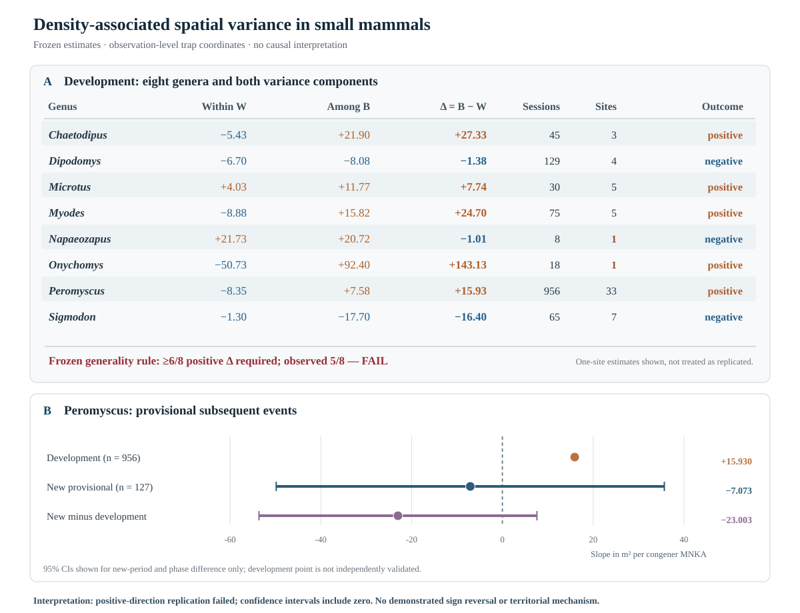

# Crowding and the allocation of spatial variance in small mammals: a failed generality test and an imprecise temporal replication

**Draft v0.2 — 16 October 2026**  
**Type:** Ecology-first working manuscript; transparent analysis of an unsuccessful generality test.  
**Submission status:** **HOLD** — failed prespecified generality criterion and unresolved transportability; NOT submission-ready.  
**Data status:** RELEASE-2026 is development/response-consumed; the 2025–2026 event-heldout source is **provisional**, not an immutable official follow-up release.  
**Author list:** Not yet specified. **No journal submission or preprint deposition has occurred.**

## Abstract

Animal populations may accommodate greater local abundance through changes in the space use of individual animals, their arrangement relative to one another, or both. Whether these responses follow a common pattern across small mammals remains uncertain. We separated three-night, trap-observed spatial variance into a within-individual component (W) and a between-individual-centroid component (B), then tested whether their associations with the minimum number known alive differed across eight genera in the North American National Ecological Observatory Network (NEON). The frozen RELEASE-2026 development analysis covered 1,326 taxon–grid sampling sessions at 40 sites. The genus-balanced abundance slopes suggested decreasing W (−4.39 m² per additional known-alive congener) and increasing debiased B (+4.98), giving a between-minus-within slope contrast of +9.37. However, the prespecified generality criterion required positive contrasts in at least six of eight genera; only five were positive. Post-result inspection suggested contrasting genus-level patterns, but these cannot be treated as independently confirmed biological modes. In subsequent, event-disjoint 2025–2026 *provisional* data, *Peromyscus* did not reproduce its prespecified positive contrast (127 sessions, 19 sites; estimate −7.07), although the site-cluster confidence interval was too wide to distinguish this estimate from zero or the developmental effect. The full five-genus follow-up comparison was not estimable. These results do not support a general or transferable spatial-packing rule. They highlight a biological question that requires adequately powered independent data: at what level of population spatial organization does abundance-associated change occur?

**Keywords:** population ecology; rodent space use; abundance; individual variation; NEON; mark–recapture; generality; replication.

## Plain-language ecological significance

A population can become more numerous without changing its overall observed spatial footprint in a simple way. The NEON development data suggested that abundance was associated with a smaller spread of repeatedly caught positions *within* animals but a larger spread of those animals' observed centres *among* animals. That contrast was **not** a general rule across the eight tested mammal genera, and its strongest independent temporal test could not resolve the sign reliably. The unresolved biological question is which populations actually change short-term individual space use versus the arrangement of individuals under crowding. The current trap observations cannot attribute either process to territoriality, competition, demographic turnover, habitat shifts or changes in capture probability.

## Introduction

A local increase in the number of small mammals need not correspond to a proportional change in the space occupied by their population. Individuals may use smaller portions of space, animal centres may become more concentrated, the occupied footprint may expand, or multiple changes may occur simultaneously. These different configurations have potentially different consequences for encounter opportunity, resource sharing and exposure to pathogens. A single estimate of home-range size or overlap need not identify which configuration occurred.

Density-associated home-range change is **not** a novel phenomenon. O'Fallon, Pinter-Wollman and Mabry (2025) used repeated NEON captures of 2,420 *Peromyscus* individuals across 36 sites, confirming a negative density–home-range association while showing interactions with sex, latitude, habitat and body condition. A 319-species mammal comparison by Santini, Jacucci and Tucker (2026) related home range, population density and inferred overlap to sociality, territoriality and habitat dimensionality. Likewise, within- and among-individual partitioning of spatial niche variation is established in movement ecology: work in the great evening bat demonstrates shifts in spatial specialization and individual niche breadth between seasons without equivalent changes in population niche breadth (Wang et al. 2023). Our paper cannot claim the first evidence for any of those component phenomena.

The narrower empirical question is whether variation in local abundance is associated differently with two *simultaneously observed* spatial degrees of freedom: the spread of repeated capture positions for a given marked animal and the spread of captured animals' average trap positions. We call these W and B, respectively. The difference in their abundance slopes, Δβ = βB − βW, asks whether the same local increase in known-alive animals is associated with a relatively stronger response within animals or among their observed centres.

The original prospective development hypothesis predicted positive Δβ, with stronger spatial packing additionally requiring a negative within-animal slope and nonnegative among-centre slope. Three independent requirements were frozen before the first W/B–abundance join: positive genus-balanced Δβ; all leave-one-genus-out coefficients positive; and at least six of the eight genus-specific contrasts positive. We report the outcome of this test **including its failure**, then evaluate how much its development-era ecological pattern transports to genuinely new trapping events without implying that a failure of a direction rule proves the opposite biological response.

## Methods

### Study universe and observation scale

We analysed standardized NEON box-trapping records at the native hierarchy of site, 10 × 10 mammal grid, site × plot × event, trapping night, trap coordinate and individually tagged animal. Eligibility was fixed to complete three-consecutive-night sessions on standard grids, saturation at or below 0.30 of available all-mammal trap-nights, a minimum of five repeat-supported animals for the spatial metrics, and taxon × grid series with at least three scored sessions and variation in genus-level minimum number known alive (MNKA). The eight fixed genera were *Chaetodipus*, *Dipodomys*, *Microtus*, *Myodes*, *Napaeozapus*, *Onychomys*, *Peromyscus* and *Sigmodon*. The study uses trap-observed locations rather than continuous telemetry, activity-centre truth or complete home ranges.

The fixed RELEASE-2026 development dataset contributed **1,326** scored taxon–grid sessions, **167** varying series, **21** taxon concepts, **eight** genera and **40** NEON sites. Across-genera site totals are not additive because taxa may occur at the same site.

### Joint within- and among-animal spatial description

W is the equal-individual average of within-tag three-night capture-coordinate variance in m²; B is the among-tag centroid variance in m² with the frozen correction for sampling imprecision in those centroids. Both use the same physical squared-distance units. We define the *within-session contrast* D = B − W. These are observation-level statistics conditional on which individuals were repeatedly captured, not direct movement or territorial metrics.

The predictor is the genus-level event **minimum number known alive**, a reconstruction from individual capture histories. It is an abundance *index*, not a randomized treatment or independent estimate of true density. **The predictor is genus-wide rather than necessarily focal-species-specific**: in places where multiple congeners co-occur, a change in MNKA need not be a change in conspecific density. We therefore cannot infer an intraspecific competitive response from this predictor alone. The frozen weighted fixed-effects regression includes taxon-concept × plot-series effects, site × calendar-month effects and calendar-year effects. Primary weights give each of the eight genera equal total contribution. Unweighted, raw-B and reduced-calendar-adjustment variants are recorded as sensitivities, not new primary estimands. The prespecified contrast is the MNKA coefficient for D; component slopes for W and B are descriptive mechanism-direction checks. Inference uses site/genus clustering with acknowledged small-cluster limitations; no nominal significance claim is made from the uncorrected two-way sandwich coefficient.

### Frozen generality rule and independent follow-up

Development success required **all** of: genus-balanced Δβ > 0, all eight leave-one-genus-out contrasts > 0 and at least **six of eight** genus-specific contrasts > 0. Failure cannot be changed to 5/8 after seeing data. The subsequent two-mode hypothesis for selected genera was explicitly generated *after* that failure and was prospectively frozen as a different programme before opening later observations.

The temporal follow-up drew from 2025–2026 NEON trapping events absent from RELEASE-2026. Original and new event/night keys were nonoverlapping, but this is **event-disjoint rather than individual-independent**: 230 marked animal histories crossed the data boundary. The source was provisional; subsequent official release changes could modify inputs. Follow-up eligibility, metric and MNKA rules were held fixed. Only *Peromyscus* contributed a sufficiently large new varying-series sample (127 sessions at 19 sites) for the directional comparison; all-five-genus mode confirmation was **not estimable**.

### Observation-process checks and calibration

The fraction of marked animals supporting within-individual repeats was audited for dependence on MNKA. A density-invariant, single-catch, three-night simulator was used as a **limited negative control**, not a complete observation model. The heldout *Peromyscus* slope was also diagnosed for identifying predictor variation remaining after the frozen fixed effects and for site-cluster imprecision. These post-result diagnostics do not revise the original success rules.

## Results

### Development: average asymmetry, unsuccessful cross-genus test

The equal-genus-weight development coefficients were βW = **−4.395**, βB = **+4.977** and Δβ = **+9.372 m² per additional genus-MNKA**. Every leave-one-genus-out Δβ remained positive. However, only **five of eight** genus-specific slopes were positive, below the prespecified six-genus minimum. The generality test therefore **FAILED** even though the pooled coefficient had the predicted sign. This failure is an absence of the required evidence of generality; it is **not proof that no population or genus can have a positive association**, or a formal test of identical effects across genera.

| Genus | Scored sessions | Sites | Development Δβ (m²/MNKA) | Descriptive W/B direction |
|---|---:|---:|---:|---|
| *Chaetodipus* | 45 | 3 | +27.33 | W down; B up |
| *Dipodomys* | 129 | 4 | −1.38 | W down; B down |
| *Microtus* | 30 | 5 | +7.74 | W up; B up |
| *Myodes* | 75 | 5 | +24.70 | W down; B up |
| *Napaeozapus* | 8 | 1 | −1.01 | W up; B up; raw-B sensitivity unstable |
| *Onychomys* | 18 | 1 | +143.13 | W down; B up; one site only |
| *Peromyscus* | 956 | 33 | +15.93 | W down; B up |
| *Sigmodon* | 65 | 7 | −16.40 | W down; B down |

### Figure 1. Development patterns and temporal uncertainty

**Figure 1.** (A) Full eight-genus development coefficients of genus-level minimum-number-known-alive abundance in within-animal observed-coordinate variance (W), debiased between-centroid variance (B) and their contrast Δ=B−W; negative and positive indicate slope direction, not causal movement or a demonstrated territorial mechanism. All eight genera are displayed, including two based on **one site** each. Genus-specific coefficients are exploratory point estimates without plotted confidence intervals; the registered sign criterion required **six** positive Δ slopes and observed **five**, so it failed. (B) The *Peromyscus* development estimate, subsequent event-disjoint **provisional** estimate and the post-result phase contrast, with site-cluster 95% confidence intervals for the provisional and phase-difference estimates only (development estimate is a point without a plotted interval). Both intervals span zero, and the new provisional interval includes the old positive coefficient. The figure therefore illustrates **non-replication of a frozen positive-direction prediction without statistically established biological reversal**. The cohorts are event-disjoint but include some shared animal histories; neither panel measures continuous movement or true activity-centre distances. Source: frozen repository receipts documented below. The SVG is a vector figure created from those frozen estimates, not a new ecological analysis.

As an explicitly *post-result* description, *Chaetodipus*, *Myodes* and *Peromyscus* suggested one repeated multi-site sign pattern (W lower, B maintained or higher), whereas *Dipodomys* and *Sigmodon* suggested another (both W and B lower, with B dropping more). These are tentative patterns in already-inspected observations, **not verified lineage-specific modes**, and site replication is uneven. There is no licensed inference that sociality or territoriality causes the contrast. The positive *Onychomys* coefficient, though numerically large, derives from just one site.

The pooled arithmetic sum βW + βB was approximately **+0.582 m²/MNKA**, versus their difference +9.372. This suggests that components can offset in the pooled development estimates, but is a *post-result decomposition*, not evidence that total population space-use variance is conserved.

### Capture/recapture selection cannot be ignored

As MNKA increased, the repeat-supported fraction decreased (frozen development slope **−0.00829** per MNKA), with negative signs in all eight genera. The simple single-catch null reproduced the decline in available within-individual repeats but yielded at most **+2.135** for Δβ across 36 simulated scenarios, versus +9.372 observed. Therefore that *particular* simplified selection mechanism did not explain the full magnitude of the pooled development result. Other density-dependent detection, habitat, trap response or individual-composition processes remain possible. Adding the number of repeat-supported individuals as a post-result covariate reduced pooled Δβ to **+6.712** but did not change the original 5/8 failure; it is not proof of causal biology or proof that selection created the pattern. The repeated-capture cohort size *m* is itself potentially selected by detectability and abundance, so adjustment can introduce conditioning or collider bias; the post-result m-adjusted fit is not a definitive correction.

### Provisional temporal follow-up: a failed direction rule, not evidence of a reversal

The frozen developmental *Peromyscus* Δβ was **+15.930 m²/MNKA** (956 sessions, 33 sites). The event-disjoint provisional-period estimate was **−7.073** (127 sessions, 19 sites). Therefore the prospective **positive point-direction rule was not replicated**. The heldout rank-aware site-cluster t(18) 95% interval was **[−49.82, +35.67]**, however, including both zero and the original +15.93 coefficient. As a purely conditional post-result illustration, under a fixed +15.93 slope and the observed heldout CR1 standard error of 20.35, a normal approximation assigns a roughly **21.7%** chance to a negative future point estimate. This is neither prospective power nor a test proving the old model. The post-result new-minus-old phase difference was **−23.003**, with corrected all-cohort site-cluster 95% interval **[−53.61, +7.61]**. Consequently neither a negative biological effect nor a temporal-regime reversal is established.

### Which spatial component contributes to the apparent time-period discrepancy?

A **post-result component decomposition of the existing, unchanged *Peromyscus* point estimates** locates the discrepancy principally in the dispersion of captured individual centroids (B), rather than a documented increase in each animal's short-term positional spread (W).

| Frozen component slope (m² per genus MNKA) | Development (956 sessions) | Provisional (127 sessions) | Provisional − development |
|---|---:|---:|---:|
| Within captured individual W | −8.348 | −2.246 | +6.101 |
| Among observed individual centroids B | +7.582 | −9.319 | −16.902 |
| Difference Δ = B − W | +15.930 | −7.073 | −23.003 |

The B coefficient changes by −16.902, contributing **73.5% of the absolute point-estimate Δ difference**. W remains negative in both phases, with its coefficient becoming less negative (change +6.101). The arithmetic identifies **which observed spatial component** is responsible for most of the two point estimates' disagreement; it **does not** identify a true population-footprint shift, prove that individuals moved towards one another, or establish a temporal regime transition. No component-specific prospective interval or mechanism test was validated for this post-result fraction. The registered overall Δ slope test remains the inferential reference, and its phase-difference confidence interval crosses zero.

This absence of discrimination has a quantifiable design component. Once site × calendar-month, plot-series and year effects were removed, the heldout retained only **2,589.7** units of residual MNKA sum of squares, versus **43,091.4** in development (~**6.0%**). Six of 19 heldout sites supplied essentially no residual MNKA variation under the frozen model. The top three sites supplied **54.9%** of the heldout identifying predictor variation, giving a *descriptive concentration-equivalent* count of **7.69** sites, not an alternative degrees of freedom.

The provisional *Dipodomys* sample produced a positive point coefficient against its frozen negative-mode prediction, but comprised only 25 sessions at three sites and does not support a reliable independent direction claim. *Chaetodipus* had no new varying-series support; *Myodes* and *Sigmodon* had only seven sessions each with very limited geographic support. Thus the five-genus follow-up is **NOT ESTIMABLE**, not merely a non-significant test.

## Discussion

### Where is crowding accommodated? The current answer is unresolved

The ecological interpretation is not that higher abundance universally compresses individual space use, nor that all mammal lineages necessarily adopt different packing strategies. The analysis estimates associations with **genus-level known-alive abundance**, which can include other species of the same genus; it is not an identified response to experimentally increased conspecific density. The frozen cross-genus generality hypothesis did not pass its own rule, and the strongest available temporal follow-up failed to reproduce its predicted positive point direction without providing sufficient precision to exclude the old slope.

The development sign structure is still biologically informative **as a hypothesis source**. It motivates the possibility that different populations may vary in the relative contribution of repeated within-animal positional spread and the dispersion of observed animal centroids. Yet this possibility already has antecedents in studies of animal range overlap, sociality and within/between spatial niche variation. The distinct future contribution of this programme would be reliable multi-population replication of the *joint density response of both components*—not the partition identity itself, home-range contraction, or the mere existence of heterogeneity.

### Why a population-level spread can hide other changes

A component-based analysis makes an important conceptual distinction: an approximately unchanged population-level spread can arise from genuinely weak component responses *or* offsetting within- and between-animal changes. In these development data, negative W and positive B slopes largely counterbalance in the genus-weighted mean. But neither the identity nor a near-zero arithmetic sum establishes compensation as an evolved strategy. Animal positions are conditioned on trapping and observation; interpreting these coefficients as intrinsic individual movement requires independent tracking or detection calibration.

### What the existing evidence establishes—and does not

| Evidence tier | State | Ecological interpretation |
|---|---|---|
| Within the original NEON development records | **Observed association** | Genus-weighted W slopes negative and B slopes positive; signs vary among genera |
| Prespecified common packing/allocation rule | **Failed frozen 6/8 guard** | No demonstrated multigenus generality under the registered decision rule |
| First subsequent *Peromyscus* events | **Failed positive sign prediction, imprecise** | Cannot distinguish a retained positive association from zero or a negative association at current precision |
| Predicted two cross-genus response modes | **Whole five-genus test not estimable** | Not confirmed; do not use selected development genera as a new independent test |
| Social spacing / territorial mechanism | **Not identified** | Trapping coordinates and abundance index do not demonstrate territorial enforcement or causal population accommodation |
| External Tanzania *Mastomys* series | **Source support passed; outcomes sealed** | A distinct one-site temporal test is feasible in record count, but no biological density–space result exists |

This distinction matters because a failure to pass a decision rule is not a conventional test proving homogeneity or heterogeneity. Likewise, a negative new point estimate with a wide interval does not identify temporal change as an ecological mechanism.

### Replication is limited by ecological contrasts, not just record counts

Adding new events does not necessarily produce independent information about density dependence. The site-by-month and animal-series controls appropriately protect the analysis against seasonal and repeated-population confounding, but require repeated high- and low-MNKA observations *within the same series and comparable seasonal strata*. In the provisional follow-up, predictor variation was unevenly distributed across sites even though the raw MNKA ranges overlapped those of development. Future ecological sampling or immutable new releases need sufficient abundance contrasts spread among independent sites, not only more records from one seasonal episode.

### External MOSA comparison is not a substitute for independent NEON replication

The long-term Tanzanian *Mastomys natalensis* archive has an outcome-blind, checksum-verified **153-month** conservative three-night cohort with 22 years supporting within-year changes in the original known-alive index. Removing all 39 detectable source-identity-warning codes still leaves all 153 months above the frozen threshold of five repeatedly caught animals. However, its published animal-to-TOE identity mapping and some same-day multiple-station entries remain unresolved. **No MOSA W, B, Δ or MNA–space ecological effect has been calculated or authorized.** Even after identity clarification, one Tanzanian trapping grid cannot independently validate a universal NEON multi-genus claim, and its 30 × 10 geometry differs from the standard NEON 10 × 10 grid.

### Limitations and falsifiable next step

All coefficients are observational associations with genus-level minimum-known-alive abundance, not randomized density effects. Three-night capture coordinates are not full home ranges; true individual centres and density-dependent capture probabilities are unknown. The eight-genus development estimates have strongly unequal numbers of sessions and independent sites despite equal-genus weighting. The 2025–2026 comparison is provisional and event-disjoint, not fully animal-independent. The negative holdout point coefficient and unverified two-mode predictions are not evidence for a confirmed mechanism reversal.

A new confirmatory experiment must prospectively provide comparable-season repeat observations spanning abundance within the same population series, sufficient independent sites, and ideally independent individual-location or detection data. It should evaluate the frozen W/B model or explicitly register a separate test before inspecting new spatial outcomes. It must retain the original failed generality and holdout decisions, rather than reclassify or pool favourable subgroups.

## Conclusion

Separating within-individual and among-individual spatial variance reveals potentially distinct abundance-associated patterns in NEON development observations. But the **hypothesized common positive contrast fails the prespecified cross-genus criterion**, and its leading temporal test is too imprecise to establish either replication or a biological reversal. The open ecological question is not whether crowding *can* alter home ranges, but **when and where population abundance is associated with changes within individuals versus in their observed spatial arrangement**. That question deserves independent, better-identified evidence, not a retrospective universal-packing claim.

## References and priority contextual sources

- O'Fallon, S., Pinter-Wollman, N. & Mabry, K. E. (2025). Uncovering multiple influences on space use by deer mice using large ecological networks. *Oecologia* 207:98. https://doi.org/10.1007/s00442-025-05731-2
- Santini, L., Jacucci, G. & Tucker, M. A. (2026). Relationship between home range and population density in mammals: the role of sociality, territoriality and habitat dimensionality. *Ecography* e07936. https://doi.org/10.1002/ecog.07936
- Wang, Z. et al. (2023). Linking changes in individual specialization and population niche of space use across seasons in the great evening bat (*Ia io*). *Movement Ecology* 11:32. https://doi.org/10.1186/s40462-023-00394-1
- Efford, M. G., Dawson, D. K., Jhala, Y. V. & Qureshi, Q. (2016). Density-dependent home-range size revealed by spatially explicit capture–recapture. *Ecography* 39:676–688. https://doi.org/10.1111/ecog.01511
- Leirs, H. et al. (2023). Twenty-nine years of continuous monthly capture-mark-recapture data of multimammate mice (*Mastomys natalensis*) in Morogoro, Tanzania. *Scientific Data* 10:798. https://doi.org/10.1038/s41597-023-02700-3

## Exact internal evidence, in reproducible priority order

1. `results/multiscale_density_joint_model_contract_v1.json` — frozen estimator/inclusion/generality rule.
2. `results/multiscale_density_development_result_v1.json` — 1,326-session eight-genus results.
3. `results/multiscale_density_heterogeneity_result_v1.json` — explicitly post-result descriptive modes.
4. `results/multiscale_density_single_catch_null_result_v1.json` — limited 36-cell observation-process null.
5. `results/multiscale_density_cohort_size_sensitivity_receipt_v1.json` — post-result m sensitivity.
6. `results/multiscale_density_future_mode_confirmation_contract_v1.json` — hypothesis created after the failed primary generality test, before provisional new responses.
7. `results/future_neon_provisional_holdout_decision_v1.json` — 127-session Peromyscus event-heldout nonreplication.
8. `results/peromyscus_holdout_precision_calibration_receipt_v1.json` — rank-aware heldout t interval, precise phase contrasts and residual information.
9. `results/peromyscus_holdout_partial_leverage_audit_v1.json` — site-level predictor-only concentration diagnostic.
10. `results/mosa_warning_removal_support_receipt_20261016.json` — outcome-blind single-site external support, never ecological effect.

**Internal author/editorial rule:** do not move this draft to any journal submission or call it a demonstrated biological density accommodation mechanism on current evidence.

**Figure-generation and CI provenance:** `manuscript/figures/figure_1_density_cross_scale.svg` is linked directly in this draft. All displayed point estimates come from `results/multiscale_density_heterogeneity_result_v1.json`, `results/future_neon_provisional_holdout_decision_v1.json`, and rank-aware `results/peromyscus_holdout_precision_calibration_receipt_v1.json`. Associated source-assertion tests protect the figure from silent data changes. This source-level check does not imply any unpublished effects have been opened. No new endpoint, trait moderator or data filtering has been added in writing this text. Provisional source and MOSA ID status must be reassessed before any later publication decision.
